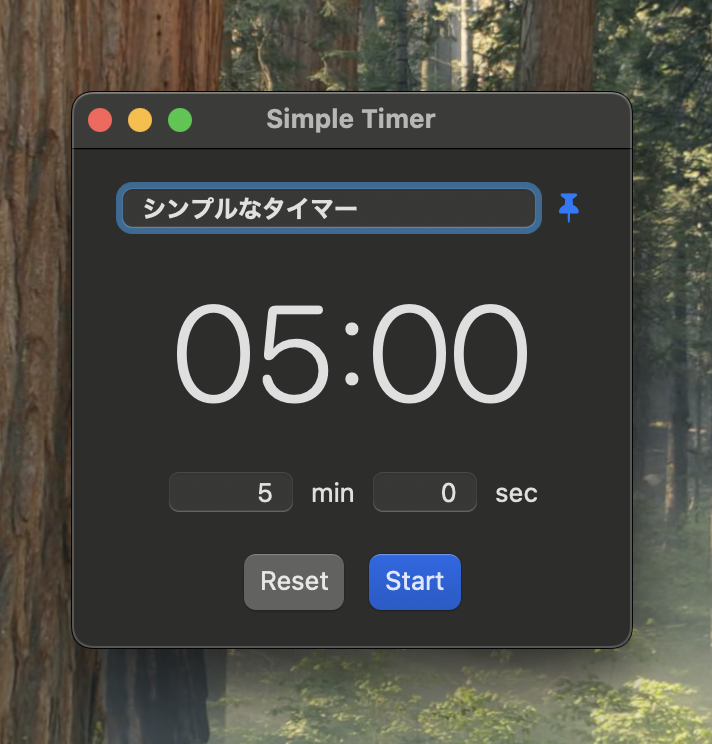

# Simple Timer
Mac用のシンプルなタイマーアプリです。

- 最前面に固定できます（右上のピンボタン）
- 時間が過ぎるとチリンと音が鳴ります
- 自由なテキスト入力欄があります

Apple Silicon搭載・macOS 14 Sonoma以降のMacのみに対応しています。

# ダウンロード方法
1. このGitHubページの右側にあるReleases欄のSimple Timer v...をクリック。
2. `SimpleTimer-macOS-AppleSilicon.zip`をクリックしてダウンロードし、展開します。
3. 現れた`SimpleTimer.app`をクリックすると、「Macに損害を与えたり、プライバシーを侵害する可能性のあるマルウェアが含まれていないことを検証できませんでした」という**警告が表示される**はずです。これは、アプリにAppleの公証がついていないためです。「完了」を押して、閉じます。
4. Macの「システム設定」→「プライバシーとセキュリティ」をクリック。「お使いのMacを保護するために”Simple Timer.app”がブロックされました」と表示されているため、「このまま開く」をクリックします。
5. 二回目以降は普通に起動できるようになります。

# Simple Timer

A simple timer app for Mac.

- Keep the window on top using the pin button in the upper-right corner.
- A chime sounds when the time is up.
- Enter any text you like in the text field.

# How to Download

1. Click **Simple Timer v...** under **Releases** on the right side of this GitHub page.
2. Download `SimpleTimer-macOS-AppleSilicon.zip` and unzip it.
3. Open `SimpleTimer.app`. You may see a warning saying that Apple could not verify that the app is free of malware that could harm your Mac or compromise your privacy. This appears because the app has not been signed with a Developer ID certificate or notarized by Apple. Click **Done** to close the warning.
4. If you trust this app, go to **System Settings → Privacy & Security**. Find the message indicating that SimpleTimer was blocked to protect your Mac, then click **Open Anyway** and confirm.
5. After this, you can open the app normally.